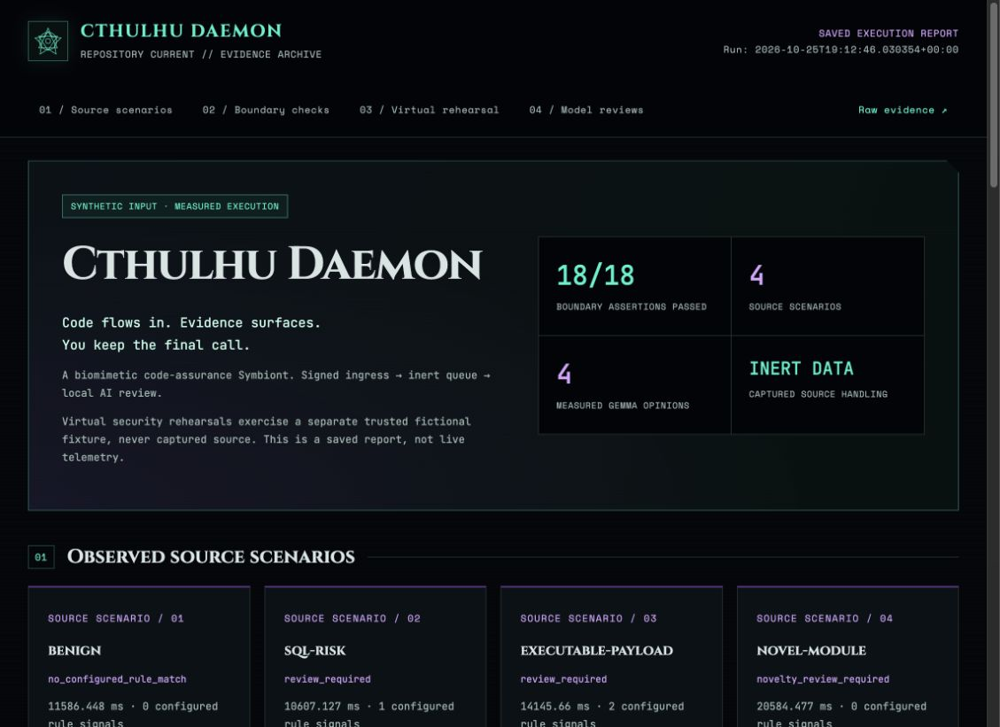

# Cthulhu Daemon

A biomimetic code-assurance Symbiont that turns signed repository changes into a bounded review report—without executing captured source.

**Code flows in. Evidence surfaces. You keep the final call.**

[Measured demo](https://cthulhu.arkhamprison.com/) · [Evidence JSON](https://cthulhu.arkhamprison.com/demo/report.json) · [Final submission](docs/SUBMISSION.md) · [Passing validation](https://github.com/robs46859-eng/arkham-creeper/actions/runs/40246949823)



## How it works

- **Sail and Tentacles:** verify webhook signatures, repository identity, and delivery replays before acknowledging durable intake.
- **Deep Water:** retain payloads and source as inert SQLite BLOBs, with bounded queues, leases, retries, and dead letters.
- **Digestion:** retrieve source at exact commit SHAs; combine IsolationForest novelty signals, configured review rules, and optional local Gemma summaries.
- **Provenance:** record source hashes, model digest, token counts, latency, and observed model unloading. Model output cannot apply patches or downgrade configured signals.
- **Virtual rehearsal:** exercise a separate trusted fictional HTTP service against tenant and consent contracts, including deliberately faulty controls.

Six animal-inspired roles organize these responsibilities; they are engineering metaphors, not six autonomous agents. See the [biomimetic design](docs/BIOMIMETIC_DESIGN.md).

## Measured evidence

The validated runtime passes **69 automated tests and 18 simulation assertions**. Its saved demonstration includes four fictional source scenarios, actual local Gemma inference, and **13 security-contract probes**. The secure fixture passes all probes; identical probes expose three tenant-boundary violations and two consent-boundary violations in the deliberately faulty controls.

The report preserves model false positives and distinguishes saved results from live telemetry. This is not an accuracy benchmark, production security certification, or a measurement of human time saved.

## Run locally

Python 3.11+ is required.

```sh
python3 -m venv .venv
.venv/bin/python -m pip install -r requirements.txt
.venv/bin/python -m unittest discover -s tests -v
.venv/bin/python -m creeper.simulate
```

Open `report.html` in the printed evidence directory; `report.json` contains the complete record. Each simulation needs a fresh directory. The default simulation uses IsolationForest only and requires no internet after dependency installation.

For measured Gemma reviews, install and start Ollama locally, then run:

```sh
ollama pull gemma3:1b
.venv/bin/python -m creeper.simulate --gemma-model gemma3:1b
```

Inference stays on `127.0.0.1:11434`; no hosted LLM API is used.

## Connect a repository

Set `CREEPER_REPOSITORIES` to exact comma-separated repository names and `CREEPER_WEBHOOK_SECRET` to a high-entropy secret of at least 32 characters. Keep credentials outside Git. Private repositories require a narrowly scoped read-only `CREEPER_GITHUB_TOKEN`. Set `CREEPER_GEMMA_MODEL=gemma3:1b` to enable Gemma in the worker.

Run the listener and worker separately against the same persistent state:

```sh
.venv/bin/python -m creeper listen --state .creeper --port 8787
.venv/bin/python -m creeper digest --state .creeper
```

Place the loopback listener behind an HTTPS reverse proxy. Configure a JSON GitHub webhook at `/webhooks/github` with the matching secret, subscribing to `push` and `pull_request`. Live delivery and source retrieval require network access. An acknowledgement confirms durable intake, not completed analysis.

## Safety boundaries

Captured source is examined as text, never imported or executed. The queue is not an OS sandbox, Gemma opinions are advisory, and no automatic patches or complete vulnerability detection are claimed. Virtual rehearsals execute only the trusted fictional fixture, not incoming code.

Keep private integrations, source snapshots, operational reports, and credentials outside the public repository. Separate installations need separate identities, secrets, allowlists, state, and report destinations.

## Documentation

- [Executive summary](docs/EXECUTIVE_SUMMARY.md) and [demo script](docs/DEMO_SCRIPT.md)
- [Architecture and limits](docs/ARCHITECTURE.md)
- [Beyond observability](docs/BEYOND_OBSERVABILITY.md)
- [Deployment](deploy/README.md) and [isolated Azure host](deploy/azure/README.md)

The report's basalt, teal, and violet theme uses embedded Cinzel, JetBrains Mono, and Space Mono fonts. It needs no JavaScript, analytics, or external font requests; [font licenses and source details](docs/fonts/README.md) accompany the assets.

## License

Application code is [MIT licensed](LICENSE). Scikit-learn retains its BSD license, embedded fonts retain the SIL Open Font License, and Gemma weights are governed separately by [Google's Gemma terms](https://ai.google.dev/gemma/terms).

The repository, package, and service identifiers retain `arkham-creeper` or `creeper` for compatibility; the project brand is **Cthulhu Daemon**.
