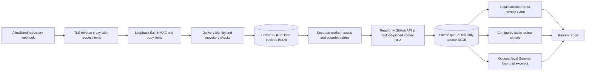

# Man o’ War orchestration

The listener acknowledges only after a SQLite transaction commits. It performs no source retrieval, model loading, shell invocation, branch changes, or imports from payloads. Repeated delivery IDs with the same body and event are idempotent; changed replays get HTTP 409.

GitHub push webhooks describe changes; complete file contents must be fetched separately. The worker uses a fixed GitHub API origin, repository names and full commit SHAs from signature-verified payloads, and checks returned path, size, and Git blob identity against the comparison/tree. This verifies the webhook, not a developer's cryptographic commit signature. Payload URLs and inline source fields are ignored. New branches use bounded tree listings. Fork PRs, nonlinear or malformed comparisons, possible truncation, symlinks/submodules, binary/oversized files, and traversal paths fail closed for review.

Deep-water memory is a private SQLite database. Source is stored in BLOBs and examined as strings. No source is imported, evaluated, made executable, patched, committed, or run. Removing execution from the pipeline is stronger than merely removing file executable bits, which would not stop an interpreter. A data queue is not an operating-system sandbox.

Each claim has a lease token. Expired jobs can be reclaimed; stale workers cannot overwrite a newer claim. Source storage and completion must acknowledge the current claim before the worker reports success; lost ownership produces `analysis_unavailable` with `LeaseLost`. Errors get exponential retries and dead-letter after three claims. Lease expiry may cause duplicate read-only analysis; exactly-once model execution is not claimed.

The local open-source AI is scikit-learn IsolationForest, trained on a reproducible synthetic benign corpus. Every report includes model version, seed, and training fingerprint. Novelty scores are advisory. Three separate configured text rules identify SQL interpolation, shell execution, and dynamic evaluation for review. SQL review signals are bounded to one per matching line; reports retain at most 256 finding details per file and explicitly record total counts and truncation. Neither a score nor a pattern match verifies a zero-day. The old prototype’s hardcoded verified findings and patch-applied claims have been removed.

When explicitly configured, a local Gemma model adds contextual review summaries and recommendations. The full prompt is bounded to 2,000 UTF-8 bytes, including deduplicated rule names and bounded display paths, within a configured 4,096-token context. It receives excerpts over loopback with proxies disabled, has no tools or execution path, cannot lower existing rule dispositions, and records model digest, token usage, elapsed time, actual excerpt coverage, and observed unload state. Digest checks before and after inference detect tag drift; the local runtime and model administration remain trusted. Malformed or unavailable inference fails the job for retry instead of silently claiming a completed model review.

The [biomimetic design](BIOMIMETIC_DESIGN.md) maps the wider six-animal concept to these implemented roles and explicitly separates proposed autonomous tracking/repair from the current build.

## Trusted virtual rehearsal

The measured simulation separately runs a fixed fictional tenant/consent HTTP service on loopback with proxies disabled. Thirteen contract probes check access, consent revocation, allowed writes, and rejected-write record preservation. They repeat against deliberate tenant-bypass and consent-bypass controls, and evidence generation requires both planted defects to be detected. The report records expected/observed outcomes and the rehearsal module's source hash.

Only the trusted built-in fixture executes. This does not execute captured source, attest to an incoming change, or certify any private/production application. The [beyond-observability direction](BEYOND_OBSERVABILITY.md) explains what additional candidate-bound adapters and isolation would be needed.

## Separate private applications

Private adapters live in a separate repository or private operations folder. Use distinct webhook secrets, read-only GitHub credentials, repository allowlists, state volumes, and service users for public and private code. Do not share queues across these boundaries. Private reports never automatically flow to the public dashboard.

A private adapter can run the actual application’s test APIs on loopback, feed an explicitly selected read-only source snapshot into its own private queue, and compare authorization and consent behavior before and after digestion. Production identity, databases, patient information, and provider calls remain outside the simulation.

## Hosting boundary

The Python listener binds to 127.0.0.1 and needs a supported HTTPS reverse proxy with request/connection limits and timeouts. Run listener and worker as unprivileged services with private state. SQLite requires one host and persistent local storage; it is unsuitable for ephemeral autoscaling instances or a network filesystem. Multi-host deployment needs a shared transactional queue implementation.

Expose only `/webhooks/github` and minimal `/healthz`. Health means the listener responds, not that GitHub retrieval or the worker is ready. Monitor pending/dead jobs and disk usage privately. HTTP 503 signals backpressure; GitHub failed-delivery redelivery must be handled operationally. Add a retention policy for completed private snapshots before production use.

The existing public UI remains a labeled simulated display until an authenticated, redacted report integration is deployed. No private source is sent to it.
